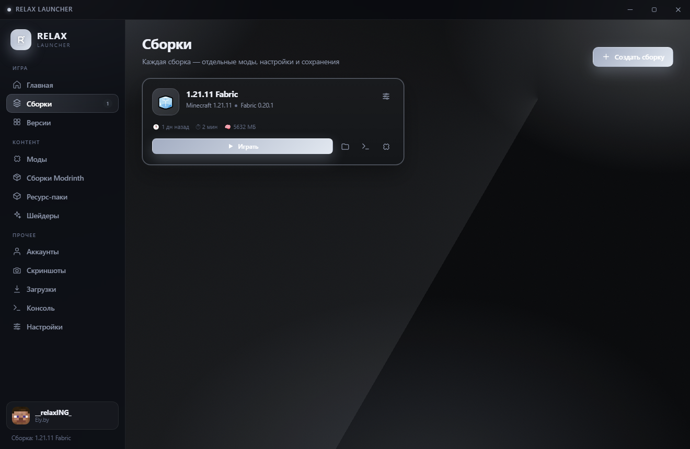
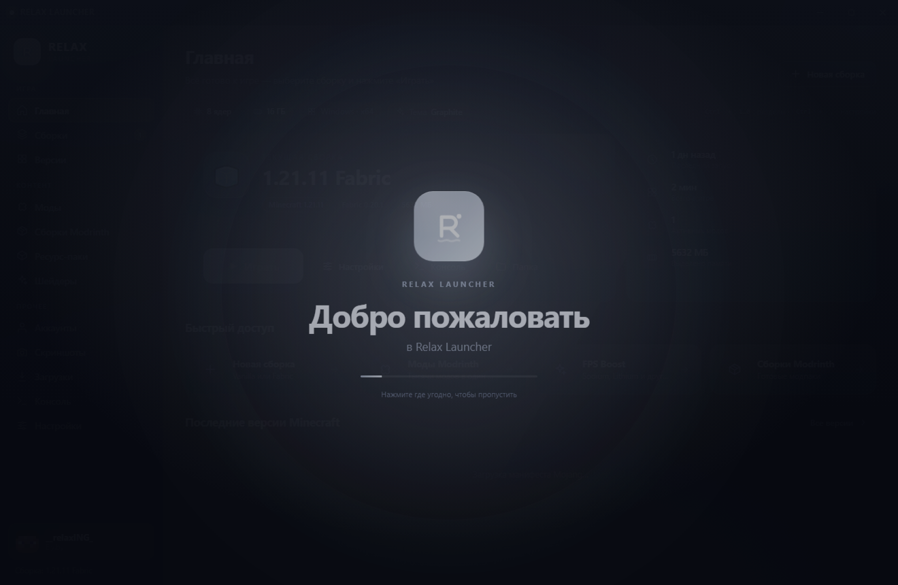

<div align="center">


# Relax Launcher

**Быстрый, лёгкий и красивый лаунчер Minecraft для Windows.**  
Vanilla, Fabric и Forge, Modrinth, Ely.by, автоподбор Java и FPS Boost — всё в одном окне.

[](https://github.com/veer47194-design/relax-launcher/releases/latest)
[](https://www.microsoft.com/windows)
[](LICENSE)
[](https://github.com/veer47194-design/relax-launcher/releases)

</div>



<details>
<summary>Приветственный экран при запуске</summary>



</details>

## Скачать

Последняя версия всегда лежит в [релизах](https://github.com/veer47194-design/relax-launcher/releases/latest).

|Файл|Что это|
|---|---|
|[Relax-Launcher-Setup-0.1.0.exe](https://github.com/veer47194-design/relax-launcher/releases/download/v0.1.0/Relax-Launcher-Setup-0.1.0.exe)|Установщик NSIS: выбор папки, ярлыки на рабочем столе и в меню «Пуск»|
|[Relax-Launcher-Portable-0.1.0.exe](https://github.com/veer47194-design/relax-launcher/releases/download/v0.1.0/Relax-Launcher-Portable-0.1.0.exe)|Portable-версия: просто скопируйте и запустите без установки|

> Установщик **не подписан цифровой подписью**. Windows может показать SmartScreen: нажмите «Подробнее» → «Выполнить в любом случае». Это нормально для локальной сборки.

## Возможности

### Игра

- **Все версии Minecraft** — манифест Mojang, релизы и снапшоты; установленные версии можно проверить или удалить.
- **Vanilla / Fabric / Forge** — Fabric из Fabric Meta, Forge через официальный installer и BootstrapLauncher. NeoForge и Quilt пока не поддерживаются.
- **Java без головной боли** — рантаймы Mojang скачиваются автоматически, системные JDK находятся сами, свою Java можно указать вручную.
- **Тонкая настройка запуска** — память, `-Xms/-Xmx`, пресеты GC (G1GC / Aikar / ZGC), свои JVM-флаги, размер окна и настоящий полноэкранный режим.
- **Диагностика крашей** — причина из crash-report, время, топ подозреваемых модов и подсказки. Кнопка «Анализ краша» и копирование диагноза.

### Контент

- **Modrinth** — моды, готовые сборки, ресурс-паки и шейдеры; поиск, сортировки, фильтры по версии MC и загрузчику.
- **Установка с зависимостями** — обязательные зависимости подтягиваются рекурсивно, `.jar` можно включать и выключать одним кликом.
- **`.mrpack`** — импорт сборок с диска или перетаскиванием в окно; `overrides/` и `client-overrides/` распаковываются, поддерживается Vanilla/Fabric/Forge.
- **FPS Boost** — Sodium, Lithium, FerriteCore, Krypton и ещё десяток оптимизаций, которые можно поставить одним нажатием.
- **Иконки модов** — читаются прямо из JAR (`fabric.mod.json`, `mods.toml`, `pack.png`), а не скачиваются из сети.
- **Экспорт сборки в `.zip`** — моды, конфиги, ресурс-паки, шейдеры и `options.txt`; по желанию сохраняются миры. В архиве лежит `relax-pack.json` с метаданными.

### Аккаунты и скины

- **Офлайн-профили** с корректным UUID (`MD5("OfflinePlayer:<ник>")`).
- **Ely.by** — вход с логином/почтой и паролем, 2FA, обновление токена при каждом запуске, `authlib-injector` и реальный accessToken в игре. Пароль не сохраняется — только токен.
- **Скин Ely.by** — превью текущей текстуры с учётом модели Classic/Slim и быстрый переход на сайт для смены.

### Интерфейс

- 12 тем, 12 пресетов акцента и свой цвет с гармоничным вторым оттенком.
- 6 фонов, свои обои с настройкой прозрачности, плотность, размер текста, 4 шрифта, режим «меньше анимаций».
- Стартовый экран «Добро пожаловать в Relax Launcher», плавные переходы и своя иконка в панели задач.
- Галерея скриншотов с просмотрщиком, история загрузок с паузой и отменой, живая консоль.
- Анимации построены на `opacity`/`transform`, длинные списки используют `content-visibility` — интерфейс не лагает на больших сборках.

## Быстрый старт

```bash
npm install
npm run build     # esbuild (main + preload) и Vite (renderer)
npm start         # запустить приложение
```

Для разработки с горячей перезагрузкой:

```bash
npm run dev
```

Проверка типов:

```bash
npm run typecheck
```

Сборка установщика и portable-версии:

```bash
npm run dist:win
# результат — в папке release/
```

> **npm 12+**: если после `npm install` Electron не запускается, разрешите скрипты:  
> `npm install-scripts approve electron esbuild` или `node node_modules/electron/install.js`.

## Горячие клавиши

|Клавиши|Действие|
|---|---|
|`Ctrl+1…9`, `Ctrl+0`|Главная, Сборки, Версии, Моды, Сборки Modrinth, Ресурс-паки, Шейдеры, Аккаунты, Скриншоты, Загрузки|
|`Ctrl+,`|Настройки|
|`←` / `→`|Предыдущий / следующий скриншот в просмотрщике|
|`F2` в игре|Сделать скриншот — он появится в галерее|

## Где хранятся данные

- Конфиг: `%APPDATA%\Relax Launcher\config.json`
- Свои обои: `%APPDATA%\Relax Launcher\backgrounds`
- Игра, версии, библиотеки, ресурсы, Java, логи: `%APPDATA%\Relax Launcher\data` (путь меняется в настройках)
- Каждая сборка: `data\instances\<id>` (моды — в `mods`, скриншоты — в `screenshots`)

## Структура проекта

```
src/
  main/        основной процесс Electron
    mojang.ts        манифест, версии, библиотеки, ресурсы, natives
    fabric.ts        Fabric Meta и профили загрузчика
    forge.ts         Forge promotions, установщик и version JSON
    ely.ts           авторизация Ely.by, токен, authlib-injector, скины
    java.ts          поиск и загрузка Java
    launch.ts        аргументы запуска, JVM-флаги, процесс игры
    modrinth.ts / mods.ts / modpack.ts   контент Modrinth
    zip.ts           чтение и запись ZIP
    instanceExport.ts  экспорт сборки в .zip
    screenshots.ts   галерея снимков
    crash.ts         разбор краш-репортов
    ipc.ts           IPC-хендлеры
  preload/     мост contextBridge (window.relax)
  renderer/    React-интерфейс
  shared/      общие типы и контракт API
scripts/       сборка и dev-запуск (esbuild + Vite)
build/         иконки для установщика
```

## Заметки

- Forge **поддерживается**: сборки с Fabric, Forge и Vanilla запускаются. NeoForge и Quilt пока нет.
- Экспорт использует собственный ZIP-writer с методом `store`: JAR и PNG уже сжаты, перепаковка не нужна. Ограничение — 4 ГБ и 65535 файлов (без ZIP64).
- Официальный API Ely.by умеет только **читать** скины — смена выполняется на сайте, а лаунчер подхватывает текстуру через authlib-injector.
- Офлайн-аккаунты запускаются с `--accessToken 0` и `--userType legacy`; для Ely.by — реальный токен, `--userType mojang` и authlib-injector.
- Для старых версий Forge (1.12.2 и ниже) нужна Java 8 — лаунчер попробует скачать подходящий рантайм Mojang.

## Лицензия

[MIT](LICENSE) © 2026 Relax
